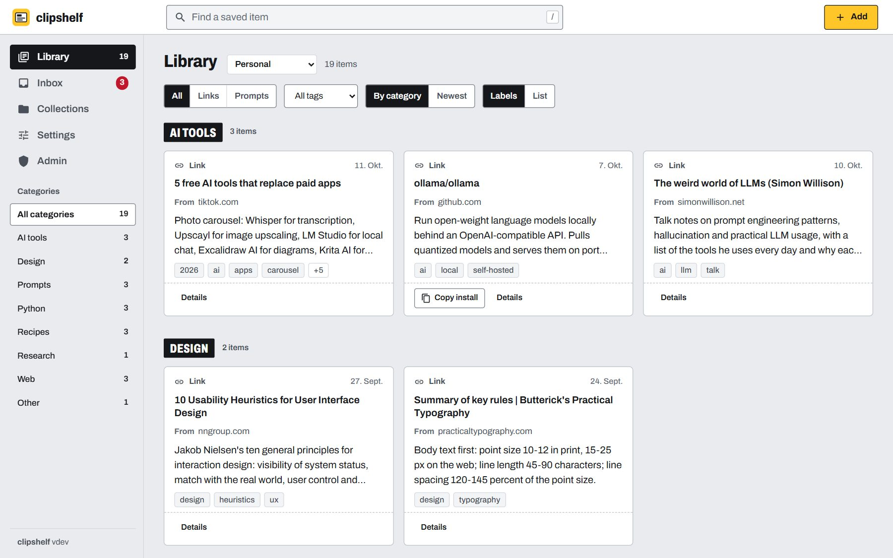

<h1 align="center">clipshelf</h1>

<p align="center">Share a link from your phone. Your server fetches the post. A vision model files it in your library.</p>

<p align="center">
  <a href="#install">Install</a> &ensp;·&ensp;
  <a href="#quick-start">Quick start</a> &ensp;·&ensp;
  <a href="docs/how-it-works.md">Documentation</a> &ensp;·&ensp;
  <a href="https://github.com/Skare69/clipshelf/releases">Releases</a>
</p>

<p align="center">
  <a href="https://github.com/Skare69/clipshelf/actions/workflows/ci.yml"></a>
  <a href="https://github.com/ottr-ai/ottr"></a>
</p>

Share a link from your phone and your own server fetches what is actually in the
post: TikTok photo carousels slide by slide with their audio, video with its ASR
captions, pages as text. A vision model you host turns that into typed link
and prompt entries (a repo is a link) with a summary and a category, not only
tags.

The Android app queues shares while offline and delivers them when it can.
Self-hosted and account-based. A local model needs no third-party service when
optional screening is off. Capture a link, then browse the entries in the
Library.



## What it is

| Piece | What it does |
|---|---|
| Django app (`clipshelf/`) | accounts, collections, capture receipts, library/search, source viewing, admin |
| Worker (`clipshelf.py worker`) | acquisition (pages, TikTok video/carousels), interpretation, retries |
| Android app (`android/`) | share-sheet capture with a durable outbox, background delivery, online browsing |
| Container (`Dockerfile`, `compose.yaml`) | one image, web + worker roles, SQLite and retained media on one data volume |

Data lives in one directory (`CLIPSHELF_DATA_DIR`): `db.sqlite3` plus `assets/`
(retained pages, images, video). The worker fetches sources and calls the model
endpoint you configure. Optional TypeSafe screening also sends capture material
and findings to its service.

## Install

### Run it locally

```
python3.13 -m venv .venv && .venv/bin/python -m pip install --require-hashes -r requirements.lock
CLIPSHELF_DEBUG=1 CLIPSHELF_DATA_DIR=./data .venv/bin/python clipshelf.py serve 127.0.0.1:8000   # shell 1
CLIPSHELF_DEBUG=1 CLIPSHELF_DATA_DIR=./data .venv/bin/python clipshelf.py worker                 # shell 2
```

The first-start details (setup wizard, admin recovery, mail) are in [docs/install.md](docs/install.md#run-it-locally).

### Deploy on the NAS

```
cp deploy/clipshelf.env.example .env      # fill in image, UID/GID, data dir, port
docker compose up -d
```

The container migrates itself on start. Open the web UI and complete the setup wizard. The full deploy steps are in [docs/install.md](docs/install.md#deploy-on-the-nas).

## Quick start

1. Start the server and the worker ([Run it locally](#run-it-locally)) or deploy the container ([Deploy on the NAS](#deploy-on-the-nas)).
2. Open the URL and complete the setup wizard. The wizard creates the first administrator.
3. Install the APK from a [release](https://github.com/Skare69/clipshelf/releases), or sign in from a browser.
4. Share a link from the phone, or paste a URL into the web **Add** dialog. Each capture returns a receipt, and a retry with the same request id never duplicates it.
5. The worker fetches the post. The model writes the summary and the category, and the entry appears in the Library.
6. Optional: paste the screening key in **Admin → Screening** and press **Test**. Without a key, nothing changes.

## Learn more

- [docs/how-it-works.md](docs/how-it-works.md) — the architecture, the capture loop, the job and outbox life cycles, and browser exports.
- [docs/install.md](docs/install.md) — first start, NAS deploy, APK versions, and API compatibility between releases.
- [docs/configuration.md](docs/configuration.md) — every setting and the hardening defaults.
- [docs/operations.md](docs/operations.md) — staging retention and cleanup, backup and restore.
- [docs/privacy.md](docs/privacy.md) — accounts, invitations, collections, and privacy defaults.
- [docs/development.md](docs/development.md) — the repo layout, the tests, mutation testing, and dependency and build pinning.
- `research/` — the plan and the research behind it.

## Contribute

Issues and pull requests are welcome.

## License

MIT — see [LICENSE](LICENSE). The bundled third-party notices and the license gate are in [docs/development.md](docs/development.md#licenses).
