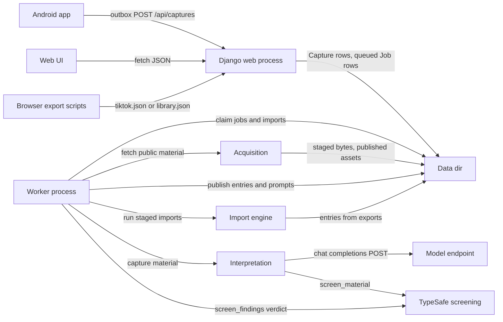
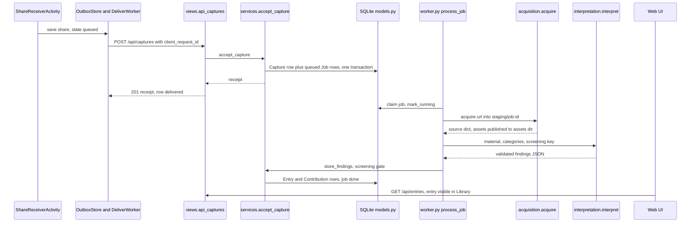
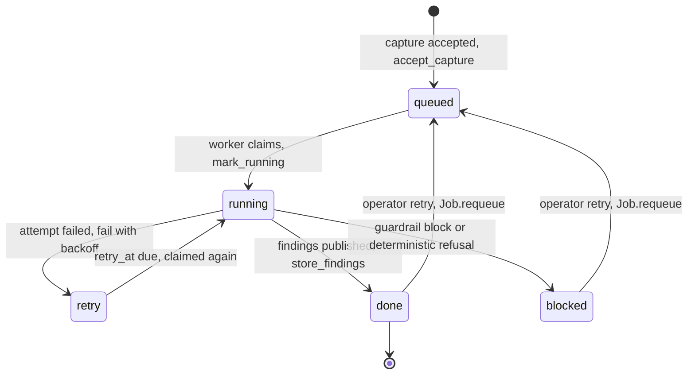
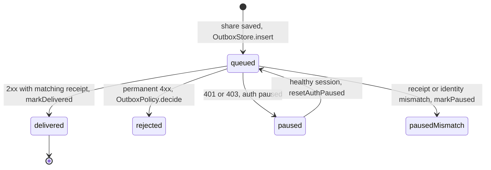

# How clipshelf works

Clipshelf is a self-hosted link shelf. A person shares a link from a phone or
pastes text in the web UI. The server fetches what is actually in the post
(page text, TikTok video with captions, photo carousels slide by slide), a
vision model that the operator hosts turns that material into typed entries
(links, repos, prompts) with a summary and a category, and the library holds
the result. It runs as one Docker image with two processes, a web process and
a worker, over one SQLite database and one media directory.

## Architecture

- **Android app** — `android/app/src/main/java/dev/clipshelf/app/` (share receiver, durable outbox, background delivery)
- **Web UI** — `clipshelf/templates/`, `clipshelf/static/` (Django templates, vanilla JS, no build step)
- **Django web process** — `clipshelf/cli.py` (`serve`, Waitress on `clipshelf/project/wsgi.py`); routes in `clipshelf/urls.py`, JSON API in `clipshelf/views.py` (`api_captures`, `api_entries`, `api_import`, `api_job_retry`), accounts in `clipshelf/accounts.py` (django-allauth), admin endpoints in `clipshelf/admin_views.py`, first-run wizard in `clipshelf/setup.py`
- **Worker process** — `clipshelf/management/commands/worker.py` starts `clipshelf/worker.py` `main()`: claims jobs (`_claim`, `_claim_batch`), acquires, interprets, publishes, and drains imports (`_claim_imports`, `_run_import`)
- **Acquisition** — `clipshelf/acquisition.py` (`acquire`, `_acquire_page`, `_acquire_tiktok`) over `clipshelf/network.py` (`validate_url`, `fetch_public`, public-IP pinning, `extractor_egress` proxy)
- **Interpretation** — `clipshelf/interpretation.py` (`interpret`, one OpenAI-compatible `POST /chat/completions` per job with one malformed-output retry)
- **TypeSafe screening** — `clipshelf/judgment.py` (`screen_material` before the model, `screen_findings` before publishing) and `clipshelf/services.py` `screening_gate`; optional, fail-open
- **Import engine** — `clipshelf/imports.py` (`run_staged_import`, `_commit_import`), admitted by `clipshelf/views.py` `api_import` or the `import_library` command (`clipshelf/management/commands/import_library.py`)
- **Publication** — `clipshelf/services.py` (`accept_capture`, `store_source`, `store_findings`) and `clipshelf/publication.py` (`contribute_link`, `publish_prompt`, dedup keys, tombstones)
- **Browser export scripts** — `tiktok-extract.js`, `whatsapp-extract.js` (run in the operator's browser; the server never takes login cookies)
- **Data dir** — `CLIPSHELF_DATA_DIR`: `db.sqlite3` (schema in `clipshelf/models.py`: `User`, `Collection`, `Membership`, `Capture`, `Job`, `Entry`, `Contribution`, `History`, `Asset`, `ServerSettings`, `Invitation`, `ImportRecord`, `ImportRequest`), `assets/` (retained media via `clipshelf/asset_files.py`), `staging/` (acquisition and import scratch, 30-day retention, `clean` command)
- **Model endpoint** — any OpenAI-compatible vision endpoint the admin configures (external, not in this repo)

The container runs both roles from one image: `Dockerfile` `ENTRYPOINT deploy/entrypoint.py`, `CMD serve`; `compose.yaml` defines the `web` and `worker` services plus the ops one-shots `bootstrap` and `verify`.

## Main use case: share a link from the phone

- **Phone** — `android/app/src/main/java/dev/clipshelf/app/ui/ShareReceiverActivity.java`
- **Outbox** — `android/.../outbox/OutboxStore.java` (rows), `outbox/OutboxPolicy.java` (limits and delivery decisions), `work/DeliverWorker.java` and `work/WorkScheduler.java` (background delivery via `androidx.work`), HTTP client `net/Api.java`
- **API** — `clipshelf/views.py` `api_captures`; a retry with the same `client_request_id` replays the receipt instead of duplicating (`services._replay`)
- **Services** — `clipshelf/services.py` `accept_capture`: validates text and URLs, resolves the destination collection, writes `Capture` plus one `Job` per URL atomically
- **Worker** — `clipshelf/worker.py` `_process_job` → `_acquire_phase` → `_interpret_phase`
- **Acq** — `clipshelf/acquisition.py` `acquire`; fetchers write into `staging/job-<id>`, then `clipshelf/asset_files.py` `publish` moves finished files to `assets/`
- **Model** — `clipshelf/interpretation.py` `interpret` and `post`; the payload is untrusted material as JSON plus images, the answer is one validated findings dict (`_validated`, `_verify_urls`)
- **Services (publish)** — `clipshelf/services.py` `store_findings`: screening gate, tombstone check, then `clipshelf/publication.py` `contribute_link` and `publish_prompt`; job ends `done`
- **Browser** — `clipshelf/views.py` `api_entries`, shell view `views.shell`

## Life cycle

The `Job` row is the life cycle of one capture URL (`clipshelf/models.py` `Job.State`):

- **queued** — written by `services.accept_capture` (`clipshelf/services.py`); claimable when `retry_at` is due (`clipshelf/worker.py` `_claimable_jobs`)
- **running** — set by `Job.mark_running` under `select_for_update` (`clipshelf/models.py`), so two workers never take one job
- **retry** — `Job.fail` schedules backoff `min(30 * 2^(attempts-1), 3600)` seconds, at most `MAX_ATTEMPTS = 5`
- **blocked** — terminal scheduled state via `Job.mark_blocked`: screening guard rail (`interpretation.GuardrailBlocked`), deterministic acquisition refusal, or attempts exhausted
- **done** — terminal success via `Job.mark_done`; a terminal-host URL ends `done` with interpretation `blocked` and stays metadata only
- **operator retry** — `POST /api/jobs/<id>/retry` → `views.api_job_retry` → `Job.requeue` (`clipshelf/views.py`, `clipshelf/models.py`)

The Android outbox row has its own life cycle (`android/.../outbox/OutboxPolicy.java`):

- **queued / delivered / rejected / paused / pausedMismatch** — `STATE_QUEUED` … `STATE_PAUSED_MISMATCH` in `android/app/src/main/java/dev/clipshelf/app/outbox/OutboxPolicy.java`
- **Delivery decision** — `OutboxPolicy.decide` maps the HTTP status: 2xx delivers, 401/403 pauses auth, a fixed 4xx set rejects, everything else retries later
- **Limits** — `OutboxPolicy`: 500 rows, 8 MiB total share text, 32768 UTF-8 bytes and 50 URLs per share; a full outbox rejects new shares and never evicts rows (`outboxFull`)
- **pausedMismatch rows stay paused** — `OutboxStore.markPaused` sets them, `resetAuthPaused` resumes only `STATE_PAUSED` (`android/.../outbox/OutboxStore.java`)
