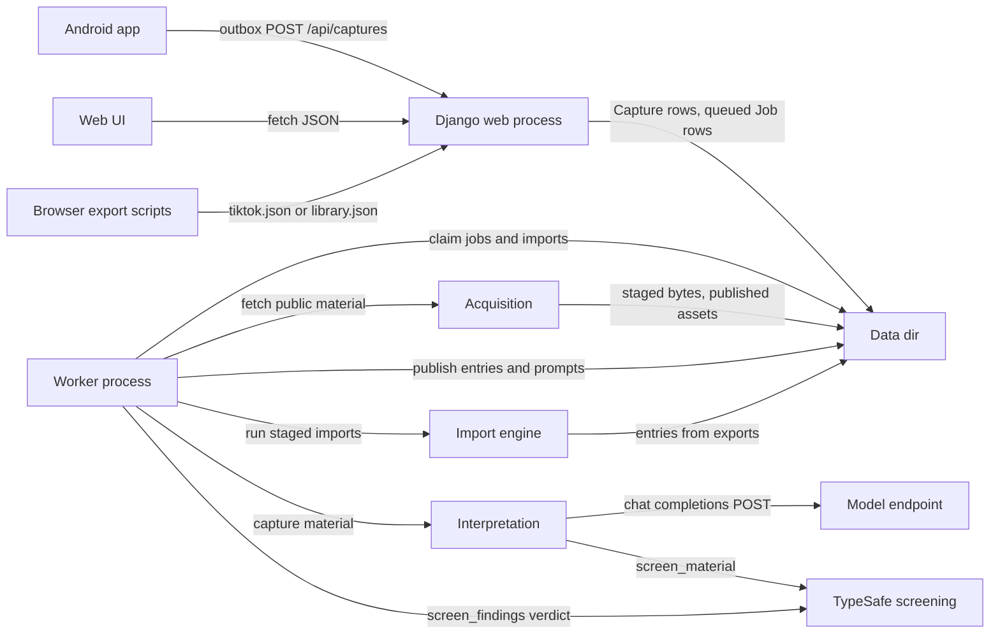
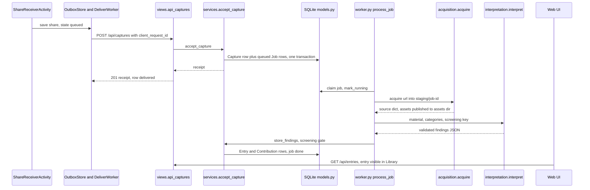
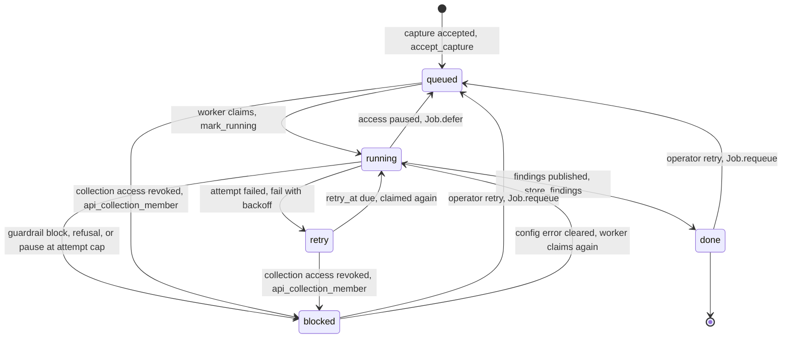
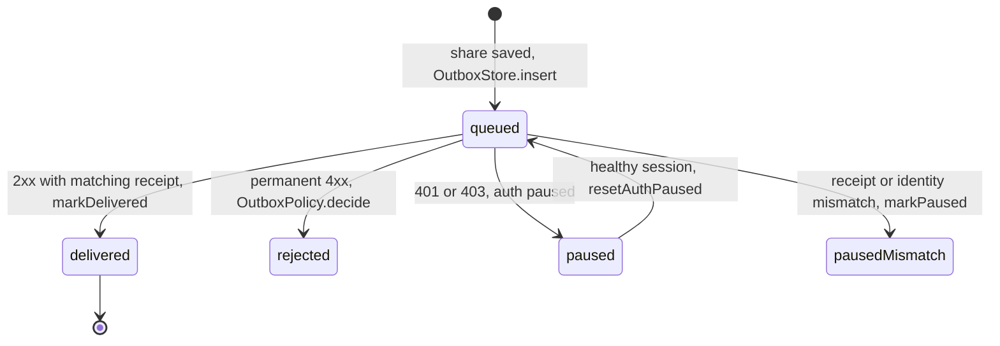

# How clipshelf works

Clipshelf is a self-hosted link shelf. A person shares a link from a phone or
pastes text in the web UI. The server fetches what is actually in the post
(page text, TikTok video with captions, photo carousels slide by slide), a
vision model that the operator hosts turns that material into typed entries
(links, repos, prompts) with a summary and a category, and the library holds
the result. It runs as one Docker image with two processes, a web process and
a worker, over one SQLite database and one media directory.

## Architecture



- **Android app** — `android/app/src/main/java/dev/clipshelf/app/` (share receiver, durable outbox, background delivery)
- **Web UI** — `clipshelf/templates/`, `clipshelf/static/` (Django templates, vanilla JS, no build step)
- **Django web process** — `clipshelf/cli.py` (`serve`, Waitress on `clipshelf/project/wsgi.py`); routes in `clipshelf/urls.py`, JSON API in `clipshelf/views.py` (`api_captures`, `api_entries`, `api_import`, `api_job_retry`, `api_follows`, `api_feed`), accounts in `clipshelf/accounts.py` (django-allauth), admin endpoints in `clipshelf/admin_views.py`, first-run wizard in `clipshelf/setup.py`
- **Worker process** — `clipshelf/management/commands/worker.py` starts `clipshelf/worker.py` `main()`: claims jobs (`_claim`, `_claim_batch`), acquires, interprets, publishes, drains imports (`_claim_imports`, `_run_import`), and checks followed sources (`_claim_sources`)
- **Followed sources** — `clipshelf/follows.py` (`create_follow`, `check_source`): profile listings over `clipshelf/acquisition.py` `list_profile_posts` (yt-dlp `--flat-playlist`, ids and URLs only), the `SeenPost` ledger, and the schedule settings on `ServerSettings`
- **Acquisition** — `clipshelf/acquisition.py` (`acquire`, `_acquire_page`, `_acquire_tiktok`) over `clipshelf/network.py` (`validate_url`, `fetch_public`, public-IP pinning, `extractor_egress` proxy)
- **Interpretation** — `clipshelf/interpretation.py` (`interpret`, one or more OpenAI-compatible `POST /chat/completions` per attempt: one malformed-output retry and one doubled-limit retry on `finish_reason=length`; output limit from Admin → Max output tokens)
- **TypeSafe screening** — `clipshelf/judgment.py` (`screen_material` before the model, `screen_findings` before publishing) and `clipshelf/services.py` `screening_gate`; optional, fail-open
- **Import engine** — `clipshelf/imports.py` (`run_staged_import`, `_commit_import`), admitted by `clipshelf/views.py` `api_import` or the `import_library` command (`clipshelf/management/commands/import_library.py`)
- **Publication** — `clipshelf/services.py` (`accept_capture`, `store_source`, `store_findings`) and `clipshelf/publication.py` (`contribute_link`, `publish_prompt`, dedup keys, tombstones)
- **Browser export scripts** — `tiktok-extract.js`, `whatsapp-extract.js` (run in the operator's browser; the server never takes login cookies)
- **Data dir** — `CLIPSHELF_DATA_DIR`: `db.sqlite3` (schema in `clipshelf/models.py`: `User`, `Collection`, `Membership`, `Capture`, `Job`, `Entry`, `Contribution`, `History`, `Asset`, `ServerSettings`, `Invitation`, `ImportRecord`, `ImportRequest`, `FollowedSource`, `SeenPost`), `assets/` (retained media via `clipshelf/asset_files.py`), `staging/` (acquisition and import scratch, 30-day retention, `clean` command)
- **Model endpoint** — any OpenAI-compatible vision endpoint the admin configures (external, not in this repo)

The container runs both roles from one image: `Dockerfile` `ENTRYPOINT deploy/entrypoint.py`, `CMD serve`; `compose.yaml` defines the `web` and `worker` services plus the ops one-shots `bootstrap` and `verify`.

## The loop

1. **Capture** — share to the Android app (saved on the phone first, delivered in
   the background) or paste into the web UI. Each capture returns a receipt; a
   retry with the same request id never duplicates it.
2. **Acquire** — the worker resolves the URL and fetches what is public: page
   text, TikTok video with its ASR captions, photo carousels slide by slide.
   Blocked or login-only posts stay saved with an honest warning and a retry or
   `tiktok.json` import path.
3. **Interpret** — one admin-managed OpenAI-compatible endpoint (any local or
   remote vision model) reads the acquired material and returns repos, prompts,
   links and a category, with warnings for anything it could not see or verify.
   The model reuses the collection's categories and names a new one only when
   none fits. GitHub READMEs are interpreted too; Hugging Face, arXiv and Colab
   pages stay metadata only.
   Pick a provider from the list — OpenAI, Anthropic, Gemini, OpenRouter, Groq,
   Mistral, xAI, Z.AI, Ollama, llama.cpp, LM Studio, vLLM, or anything else you type —
   and the model names are fetched from that endpoint rather than guessed.

   The fetch pass starts after the first model call returns: the worker
   re-verifies the github.com and gist.github.com URLs that occur in the
   acquired material — `_verify_urls` (`clipshelf/interpretation.py`) fetches
   at most 20 of them, 64 KiB each, and only the material selects and orders
   them; model output never triggers a fetch, and an unreachable model
   endpoint costs no fetches. Only screening flags at or above the action
   threshold (`judgment.ACTION_STEER`, 0.70) skip these fetches; a lower
   review-level flag does not. After the model answers, `_warn_unverified_urls` adds an
   "unverified" warning to every emitted link whose fetch failed, so a failed
   check warns instead of blocking. Emitted URLs that the 20-URL cap
   dropped get a "N URL(s) not re-verified" warning with the exact count;
   the capture's own URL never takes a fetch slot, because acquisition
   fetched it already, and alias spellings (case, scheme, www, fragment,
   trailing slash) of one URL share a slot.
4. **Browse** — Library and Inbox per collection, search, categories, source
   viewing, retry. Collections are the access boundary: everyone has a private
   Personal collection, shared collections have explicit members.

Captured pages are untrusted input. Optionally, clipshelf screens each capture
for prompt injection with a TypeSafe System One battery before it reaches the
model, and screens its findings before publishing — imported items included:
when screening flags an import, its install command, summary and interpreted
flag are withheld with the findings, and only a blocked job remains. Paste the
key into **Admin →
Screening** (or set `TYPESAFE_API_KEY` in the compose `.env`) and press Test.
Screening degrades to a visible warning on failure, and without a key nothing
changes. In the Inbox, a job that the guard rail blocks shows "Held by screening" with
the reason, and screening warnings show in its notes.

## Browser exports

- `tiktok-extract.js` — browser export for login-required posts; the server never takes TikTok cookies
- `whatsapp-extract.js` — browser export of one WhatsApp Web chat as a `library.json` file for the import section of the web **Add** dialog: links, images, and URL-free notes (imported as prompts); re-runs export only new messages

## Followed sources

Follow a TikTok creator profile in **Settings → Followed sources** with a topic
tag. The worker lists each enabled profile on a schedule (every 6 hours by
default), reads post ids and URLs only, and queues each new post as an
ordinary capture with the topic tag on the entry. The first check after a
follow queues at most the newest 50 posts (the backfill cap); older posts in
the listing window are recorded as seen and never queued, unless you turn on
"Include older posts on the first check".

- A seen-post ledger with a unique constraint per source and post means a post
  is never queued twice, even when two listings run at the same time.
- A failed listing (private post, region block, bot challenge) shows the
  reason on the source row, keeps the last check time, marks nothing as seen,
  and retries with the same backoff as capture jobs.
- Pause stops the checks for one source; remove stops them and deletes the
  ledger. Posts already in the library stay.
- `GET /api/feed?since=<ISO time>&tag=<tag>&limit=<n>` returns the entries
  added since a timestamp across your collections, newest first, for external
  readers.
- The schedule and the cap are operator settings
  (`api/admin/follows-settings`); see [configuration.md](configuration.md).

## Main use case: share a link from the phone



- **Phone** — `android/app/src/main/java/dev/clipshelf/app/ui/ShareReceiverActivity.java`
- **Outbox** — `android/.../outbox/OutboxStore.java` (rows), `outbox/OutboxPolicy.java` (limits and delivery decisions), `work/DeliverWorker.java` and `work/WorkScheduler.java` (background delivery via `androidx.work`), HTTP client `net/Api.java`
- **API** — `clipshelf/views.py` `api_captures`; a retry with the same `client_request_id` replays the receipt instead of duplicating (`services._replay`)
- **Services** — `clipshelf/services.py` `accept_capture`: validates text and URLs, resolves the destination collection, writes `Capture` plus one `Job` per URL atomically
- **Worker** — `clipshelf/worker.py` `_process_job` → `_acquire_phase` → `_interpret_phase`
- **Acq** — `clipshelf/acquisition.py` `acquire`; fetchers write into `staging/job-<id>`, then `clipshelf/asset_files.py` `publish` moves finished files to `assets/`
- **Model** — `clipshelf/interpretation.py` `interpret` and `post`; the payload is untrusted material as JSON plus images, the answer is one validated findings dict (`_validated`; `_verify_urls` fetches material GitHub URLs once, after the first model call returns, `_warn_unverified_urls` maps fetch failures to warnings after it)
- **Services (publish)** — `clipshelf/services.py` `store_findings`: screening gate, tombstone check, then `clipshelf/publication.py` `contribute_link` and `publish_prompt`; job ends `done`
- **Browser** — `clipshelf/views.py` `api_entries`, shell view `views.shell`

## Life cycle

The `Job` row is the life cycle of one capture URL (`clipshelf/models.py` `Job.State`):



- **queued** — written by `services.accept_capture` (`clipshelf/services.py`); claimable when `retry_at` is due (`clipshelf/worker.py` `_claimable_jobs`)
- **running** — set by `Job.mark_running` under `select_for_update` (`clipshelf/models.py`), so two workers never take one job
- **retry** — `Job.fail` schedules backoff `min(30 * 2^(attempts-1), 3600)` seconds, at most `MAX_ATTEMPTS = 5`
- **token totals** — the worker adds each model call's usage to the job (`Job.prompt_tokens` / `Job.completion_tokens`). The job JSON reports the totals as `tokens` (`{"prompt", "completion"}`) (`clipshelf/views.py` `_job_json`)
- **running → queued** — collection or account access loss pauses the job: `_process_job` calls `Job.defer` (`clipshelf/worker.py`); each pause cycle spends one attempt, and `Job.defer` blocks at the cap (`clipshelf/models.py`)
- **blocked** — resting state via `Job.mark_blocked`; `retry_at` clears, so no retry is pending: screening guard rail (`interpretation.GuardrailBlocked`), deterministic acquisition refusal, attempts exhausted, or member revocation
- **blocked → running** — auto-resume: the worker claims a `blocked` job with error `llm-not-configured` again when the LLM is configured (`clipshelf/worker.py` `_claimable_jobs`)
- **queued/retry → blocked** — member removal blocks the member's pending jobs with `collection access revoked` in the same request (`clipshelf/views.py` `api_collection_member`)
- **done** — terminal success via `Job.mark_done`; a terminal-host URL ends `done` with interpretation `blocked` and stays metadata only
- **operator retry** — `POST /api/jobs/<id>/retry` → `views.api_job_retry` → `Job.requeue` (`clipshelf/views.py`, `clipshelf/models.py`)

The Android outbox row has its own life cycle (`android/.../outbox/OutboxPolicy.java`):



- **queued / delivered / rejected / paused / pausedMismatch** — `STATE_QUEUED` … `STATE_PAUSED_MISMATCH` in `android/app/src/main/java/dev/clipshelf/app/outbox/OutboxPolicy.java`
- **Delivery decision** — `OutboxPolicy.decide` maps the HTTP status: 2xx delivers, 401/403 pauses auth, a fixed 4xx set rejects, everything else retries later
- **Limits** — `OutboxPolicy`: 500 rows, 8 MiB total share text, 32768 UTF-8 bytes and 50 URLs per share; a full outbox rejects new shares and never evicts rows (`outboxFull`)
- **pausedMismatch rows stay paused** — `OutboxStore.markPaused` sets them, `resetAuthPaused` resumes only `STATE_PAUSED` (`android/.../outbox/OutboxStore.java`)

The Android outbox holds at most 500 rows and 8 MiB of UTF-8 share text across
all accounts on the phone. One share may hold at most 32768 UTF-8 bytes and 50
URLs. A full outbox rejects new shares and never evicts stored rows; delivered
rows count until you clear them, and paused or rejected rows can be deleted.
Android OS backup and device-to-device transfer are off
(`android:allowBackup="false"` plus the exclude-all `data_extraction_rules.xml`
and `backup_rules.xml`), so undelivered shares remain on this phone only.

## Migrating an existing `library.json`

From the running app, an old `library.json` goes through the import section of
the **Add** dialog, like a TikTok export; entries land in the collection you pick. Media referenced
by the old library is retained only when the old `cache/` directory was copied
to `<data dir>/import-cache` on the server first; otherwise the manifest lists
what was missing.

For offline or bulk imports there is the management command:

```
python clipshelf.py import_library --user you@example.com --input library.json --cache cache --dry-run
python clipshelf.py import_library --user you@example.com --input library.json --cache cache
```

The dry run reports a manifest digest and counts, and imports nothing.
The real run imports into that account's Personal collection
only; the original files are never modified and a repeated import is a no-op.
